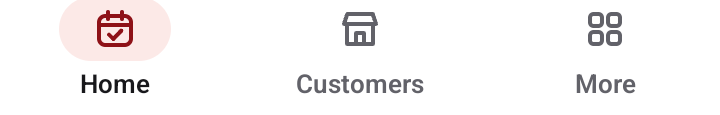
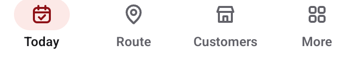
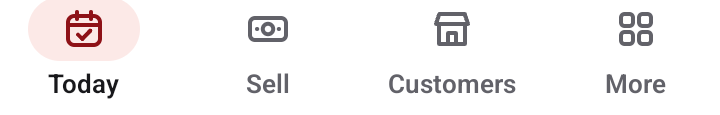
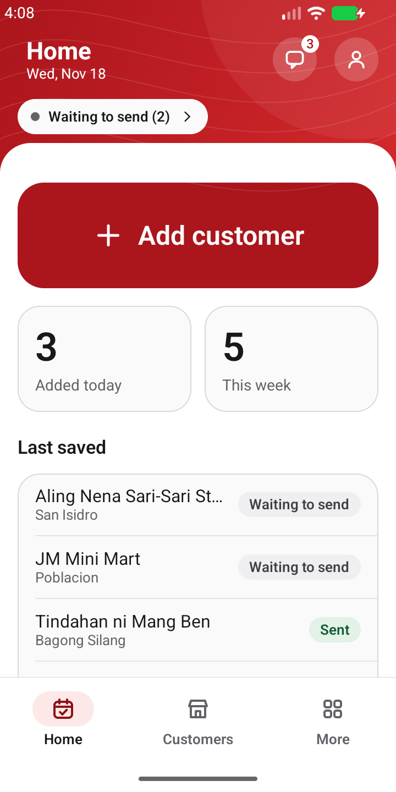
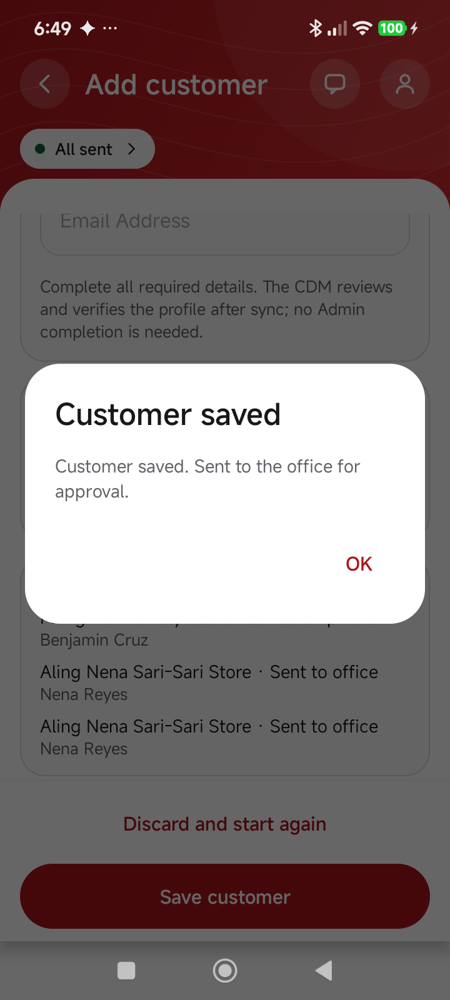
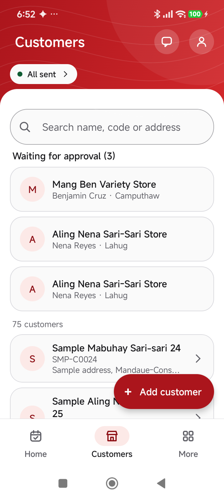
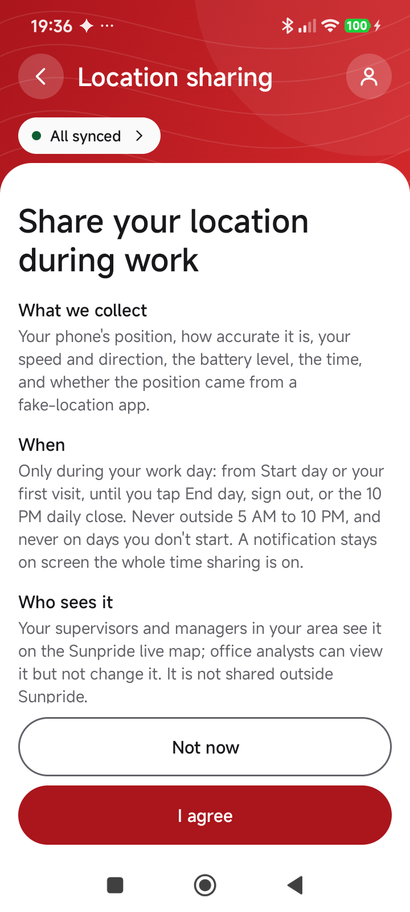
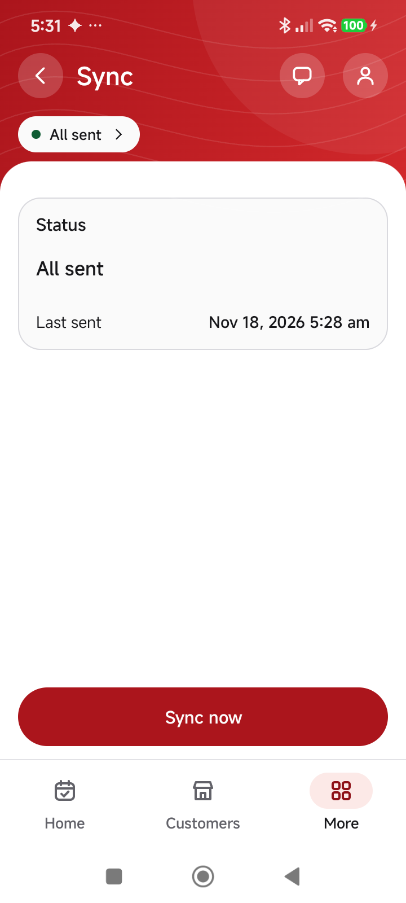

# Sunpride Field app: guide for salesmen

**For salesmen.** There is one phone app: **Sunpride Field**. The Van app is no longer used. Selling from the truck is inside Sunpride Field.

## A. First time only

1. Install the app from Google Play. See the guide **Install the Field app (Google Play)**.
2. Open the app. Type your email and password. Tap **Sign in**.
3. You see **Register phone**. Tell your office admin: "My phone is waiting."
4. Wait. The app checks by itself. When the office is done, the app opens.
5. Stay where you have signal for a few minutes. The app downloads your lists.

## B. Your app mode

The office picks what you see in the app. This is your **app mode**. When the office changes it, the app changes by itself at the next sync. You do not need to reinstall.

   - **Customer mapping**: add and update customers. Bottom bar: **Home · Customers · More**.
   - **Field visits**: store visits, route and orders. Bottom bar: **Today · Route · Customers · More**.
   - **Truck selling**: sell from the truck and print receipts. Bottom bar: **Today · Sell · Customers · More**.

  

**Messages** is the speech-bubble icon at the top right, in every mode. A number on it means new messages.

## C. Customer mapping: add customers

6. On **Home**, tap **Add customer**.
7. Fill in every field with a red star (*). Take the storefront photo. Tap **Use my location** at the store.
8. Tap **Save customer**. You see **Customer saved**. Tap **OK**.

Full steps with pictures: see the guide **How to add customers**.

  

## D. Field visits and Truck selling: your day

9. Open the app. On **Today**, tap **Start day**.
10. The app asks to share your location while you work. Read it, then tap **I agree**.
11. Visit your stores from **Today** or **Route**.
12. **Truck selling** only: tap **Sell** to load the truck, sell and print receipts, take returns, count cash and stock, and close the trip. The **Sell** tab shows only when the office has set you up for selling.
13. At the end of the day, tap **End day**.

## E. Sync: is everything sent?

14. The pill at the top shows **All sent** or **Waiting to send**.
15. Tap **More**, then **Sync**. Tap **Sync now** when you have signal.

**What the words mean:**

   - **Waiting to send**: saved on your phone, not sent yet. It sends by itself when you have signal.
   - **Sent**: the office has it.
   - **Waiting for approval** (top of **Customers**): the office is checking a customer you added.
   - After approval the customer is in your **Customers** list with its Customer Code.

**No signal?** You can still work. Everything is kept on your phone and sent later. **Never uninstall the app or clear its data.** Work that is not sent would be lost.

> **If something goes wrong**
> Phone stuck on **Register phone**, or a question about a customer: call or text your **office admin**.
> The app shows an error: tap the speech-bubble icon and message a **Developer** (Mark Aven, Dominic Solomon or Aries Go). Or tap **More**, then **Report an issue**. Say what you tapped and send a screenshot.
