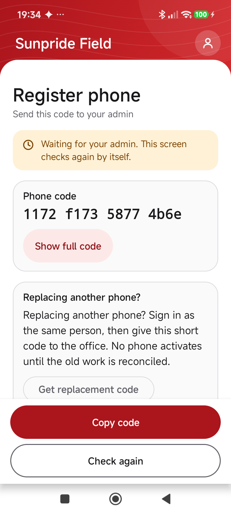

# Install the Sunpride Field app (Google Play)

**For salesmen and anyone who uses the phone app.** There is one phone app for field work: **Sunpride Field**. Do this once on your work phone. After that, new versions install by themselves.

## A. Before you start

1. On your phone, open the **Play Store** app.
2. Tap your profile picture (top right). Check that the Play Store uses the **Gmail the office has for you** (the Gmail that got the invite). If it shows another account, switch to that Gmail.

*Google Play only works with a Gmail address. If your email in the system is not a Gmail, send your Gmail to the office first.*

## B. Install

3. On the same phone, open this link: **https://play.google.com/apps/internaltest/4701513704454726563**
4. Tap **Accept invite**.
5. Tap **Download it on Google Play**.
6. In the Play Store, tap **Install**. If you already have Sunpride Field, tap **Update** instead.
7. The Play Store may show the name **com.sunpride.field.beta (unreviewed)**. That is normal.

## C. First sign-in

8. Open **Sunpride Field**. Type your email and password. Tap **Sign in**.
9. First time on this phone: you see **Register phone**. Do nothing. Tell your office admin: "My phone is waiting."
10. Wait. The screen checks by itself. When the office is done, the app opens.
11. Stay where you have signal for a few minutes. The app downloads your lists.

> **If something goes wrong**
> The link says the app is not available: send the office the Gmail your Play Store uses. They add it, then try step 3 again.
> Google Play does not work at all: ask the office for the backup download folder: https://drive.google.com/drive/folders/181uAAjyMxw08WoDKSGaumrTPPZvQA282 . Download the newest file, open it, allow installing if the phone asks, then tap **Install** or **Update**.
> Never uninstall the app first. Uninstalling deletes work that is not sent yet.
