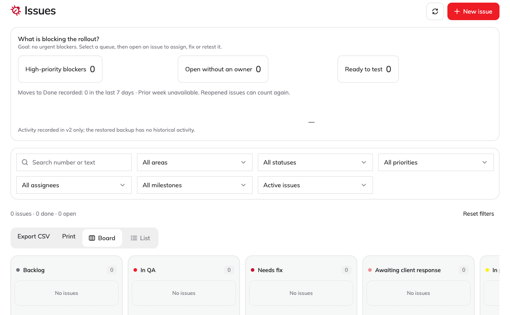
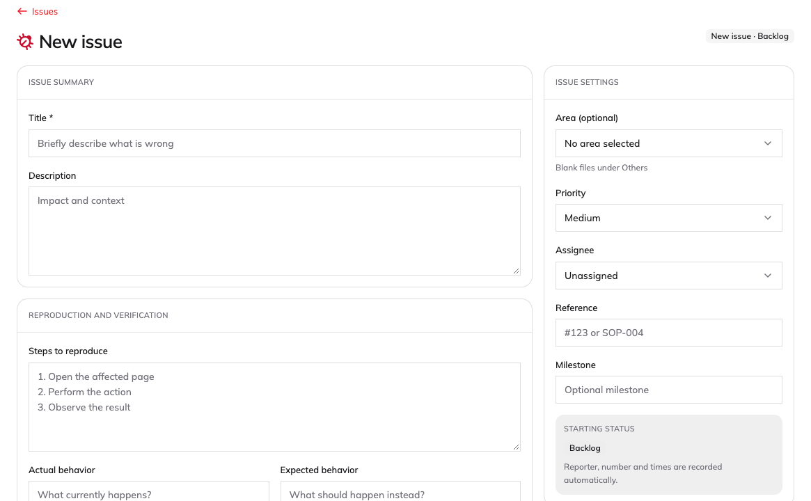
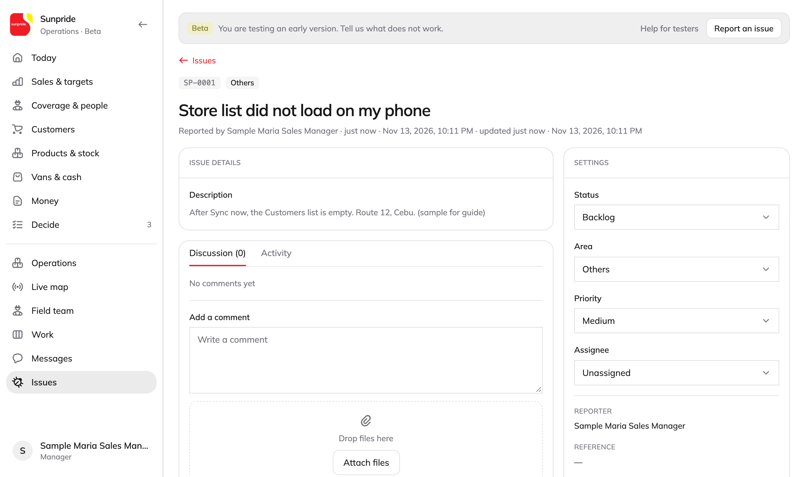

# Sunpride Issues: report a problem and follow it

**For everyone.** Issues is the board where you report a problem or ask for a change, and watch it until it is fixed.

## A. Issue or message?

   - **Issue:** a problem or a request that needs fixing and follow-up. Example: *"The customer list is empty after Sync now."*
   - **Message:** a quick question. Use **Messages** for this (see the Messages guide).

Not sure? Message a **Developer** (Mark Aven, Dominic Solomon or Aries Go). They make an issue if one is needed.

## B. Open Issues

1. **On the phone:** tap **More** at the bottom, then **Report an issue**. Your phone opens the website. Sign in with the same email and password as the app.
2. **On the website:** click **Issues** in the menu on the left, or **Report an issue** at the top of any page.

## C. Report a problem

3. Click **New issue** (red button).
4. **Title**: one short line, for example *Customer list did not load on my phone*.
5. **Description**: what happened, where (customer, order, route), and when.
6. If you can, fill **Steps to reproduce**, **Actual behavior** (what happened) and **Expected behavior** (what should happen).
7. Add a screenshot or photo with **Attach files**.
8. Leave **Area**, **Priority** and **Assignee** as they are if you are not sure. The team sets them.
9. Click **Save**. You see your issue with its number, for example **SP-0001**. Keep this number.

 

## D. Follow your issue

10. Open **Issues** and type your number or a word in **Search number or text**.
11. Open your issue. Read the comments. To reply, type in **Add a comment**, then click **Comment**.
12. Check the **Status**:

   - **Backlog**: received, waiting its turn.
   - **In progress**: a developer is working on it.
   - **Awaiting client response**: we need an answer from you. Read the comments and reply.
   - **In QA**, **Needs fix**, **Ready for retest**: the fix is being checked. If asked, try it again and comment what you see.
   - **Done**: fixed. If it is still wrong, add a comment.

You do not get an email or phone alert for issues. Open your issue to check for news.

> **If something goes wrong**
> Cannot open Issues on the phone: sign in to the website in the phone's browser with your app email and password. Cannot save: the **Title** is required. Urgent (you cannot work): also message a **Developer** with your issue number.
