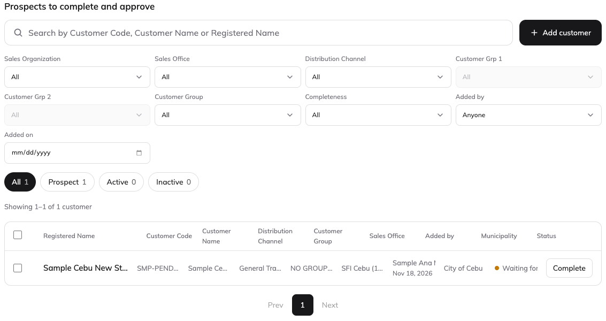
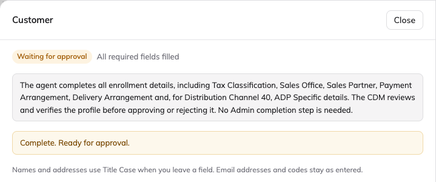
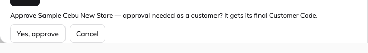
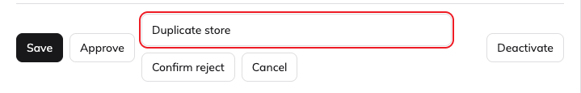
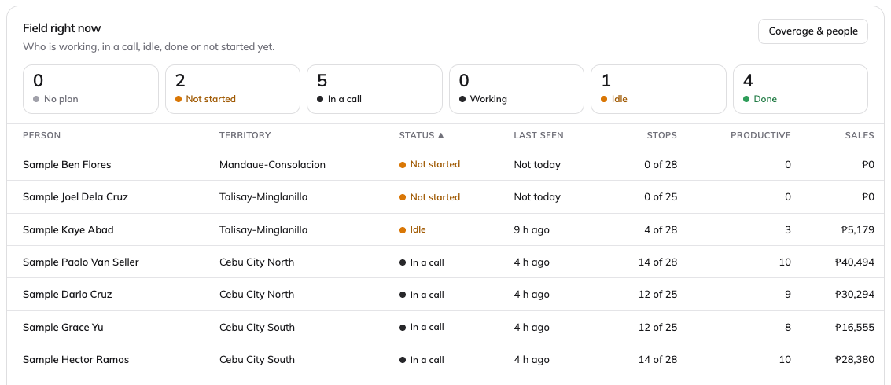
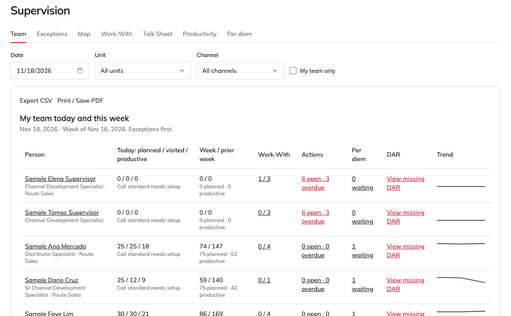

# Sunpride website: guide for managers

**For managers.** Website: **sunpride.cauldnclark.com**. You approve or reject the new customers that salesmen add, and you watch your field team.

## A. Sign in

1. First time: open the link in the email from the office (**sunpride.cauldnclark.com/register**). Type your **Full name**, your **Email** and a password. Click **Create account**.
2. Next times: open **sunpride.cauldnclark.com**. Type your email and password. Click **Sign in**.

## B. Approve or reject a new customer

Salesmen fill in every field on the phone. You check the customer and approve or reject it. Office admins can approve too.

3. Click **Customers**, then the **New customers** tab. The number on the tab shows how many are waiting.
4. Under **Pin to confirm**, click **See the pin on a map**. Click **Pin is right** or **Pin is wrong**.
5. Under **Prospects to complete and approve**, click **Complete** on a customer to open it.
6. Look at the top. **All required fields filled** means it is ready. **Incomplete — from field app** means some fields are missing: ask your office admin to fill them.
7. Check the name, address, mobile number and the other fields.
8. Good customer? Scroll to the bottom. Click **Approve**, then **Yes, approve**.
9. The top says **Approved. Customer Code …**. After the salesman's next sync, the customer is in his **Customers** list.
10. Wrong customer (for example a duplicate)? Click **Reject**. Type the reason. Click **Confirm reject**. The salesman sees your reason on his phone.

 

*You cannot approve a customer you added yourself. Another manager or an office admin must do it.*

## C. Watch the field team

11. Click **Today**. **Field right now** lists every field person with **Status** and **Last seen**: **No plan**, **Not started**, **In a call**, **Working**, **Idle** or **Done**.
12. Click a name to see that person's day: visits, **Trail** and **New stores added**.
13. Click **Live map** to see where people are now.
14. Click **Field team** for each person's planned, visited and productive calls today and this week.

 

> **If something goes wrong**
> A customer is incomplete, a pin looks wrong, or a salesman's phone is not working: contact your **office admin**.
> The website shows an error: message a **Developer** (Mark Aven, Dominic Solomon or Aries Go) in **Messages**. Say what you clicked and send a screenshot.
