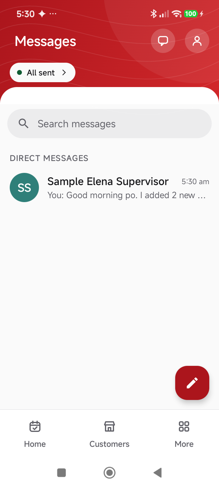
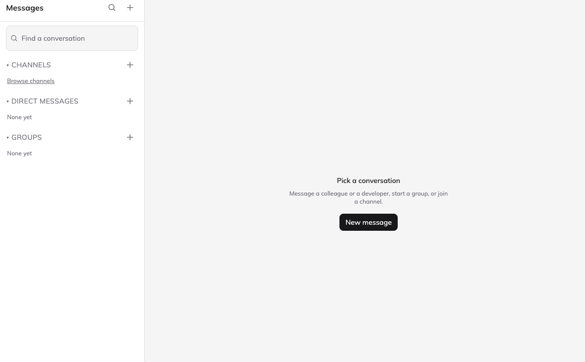
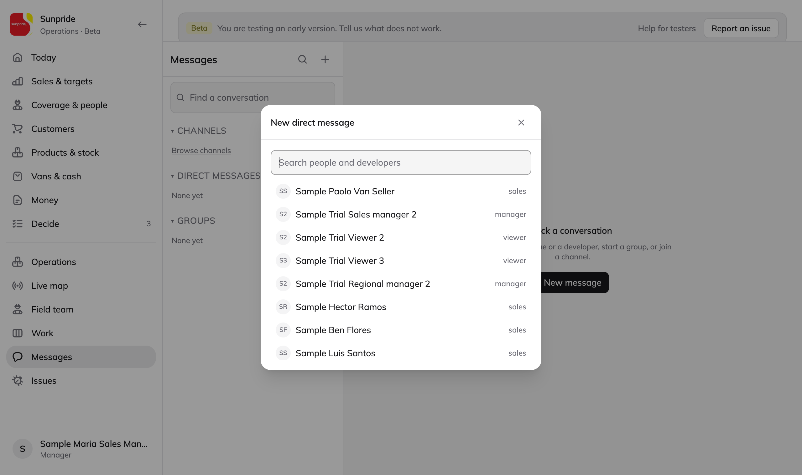
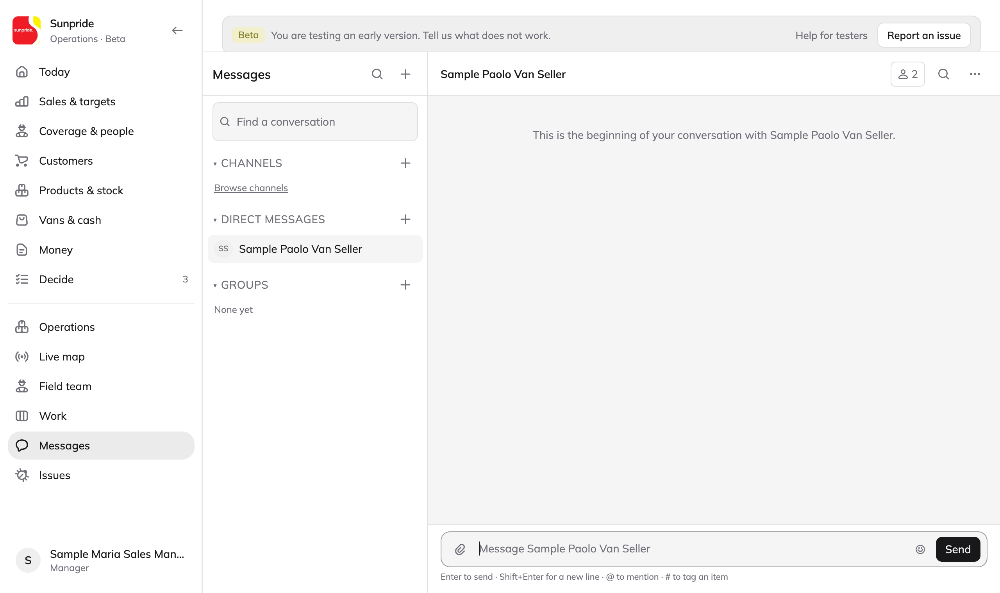

# Sunpride Messages: chat with your team and the developers

**For everyone.** Salesmen use the **Sunpride Field** app. Managers and the office use the website **sunpride.cauldnclark.com**.

## A. Who to message

   - **A question about the app** (it is slow, a button does not work, you cannot sign in, a number looks wrong): message **Mark Aven**, **Dominic Solomon** or **Aries Go**. They have a **Developer** tag next to their name.
   - **A business question** (prices, targets, routes, approvals, your schedule): ask **your manager** or **Loren**.

## B. Open Messages

1. **On the phone:** tap the **speech-bubble icon** at the top right. A number on it means you have unread messages.
2. **On the website:** click **Messages** in the menu on the left.

 

## C. Send a message

3. **Phone:** tap the **pencil** button. **Website:** click **New message** (or the **+** next to **Direct messages**).
4. In **Search people and developers**, type the first letters of the name, for example *Mark*.
5. Tap the name. Developers have the **Developer** tag.
6. Type your message in the box at the bottom. Say what you were doing, what happened, and which customer or order.
7. To add a screenshot or photo, tap the **paper clip** (**Attach files**).
8. Tap **Send**.

 

## D. Read the answer

9. The conversation stays in your list under **Direct messages**. A number next to it shows new messages.
10. Open it to read. Reply in the same conversation, so the developer sees the whole story.

**Good to know:** **New group** lets you talk to 3 or more people at once. Messages need internet to send.

> **If something goes wrong**
> Messages does not open: connect to the internet, close the app, open it again. You cannot find a developer: type only the first name. For a problem that must be fixed and followed up, use **Issues** (see the Issues guide).
