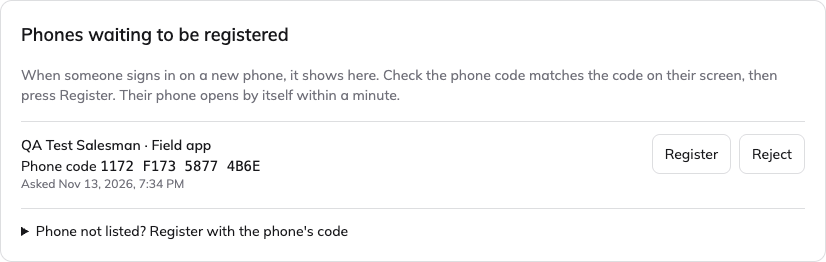
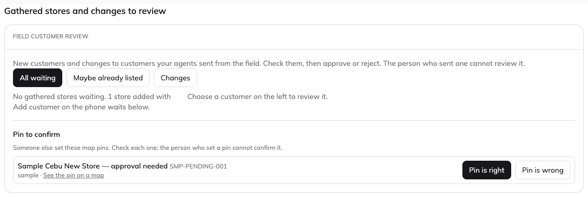
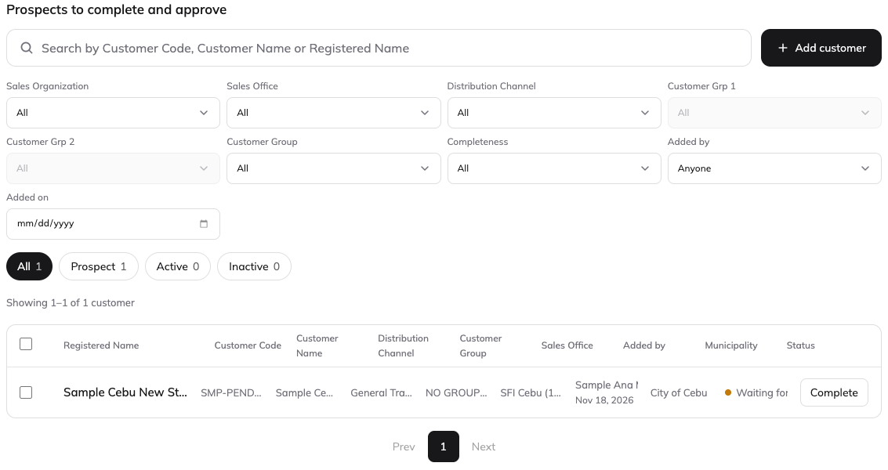
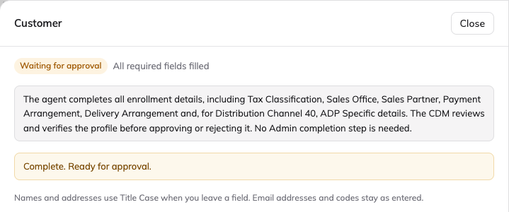
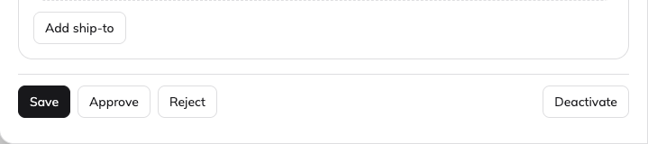
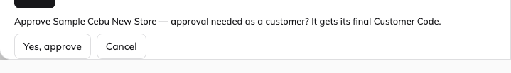
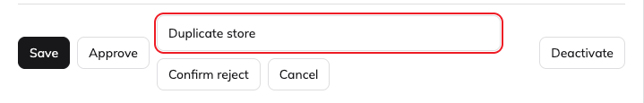
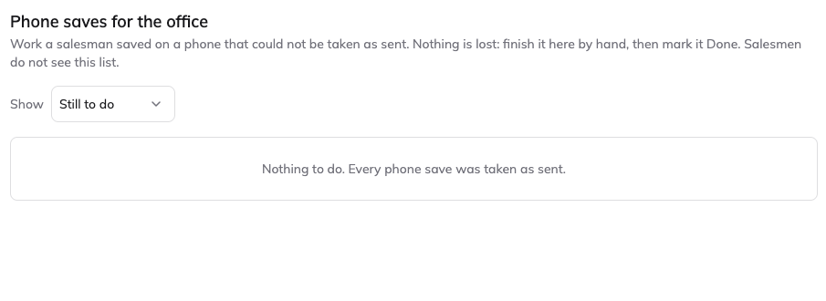
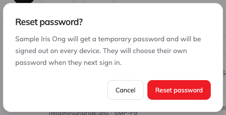
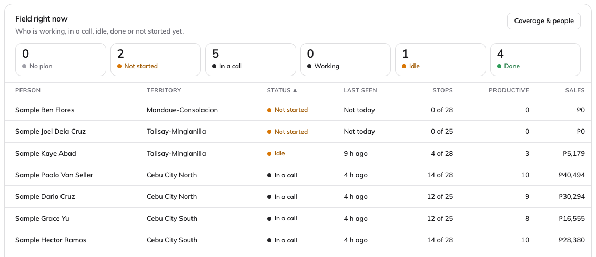

# Sunpride website: guide for the office

**For office admins (Loren's team).** Website: **sunpride.cauldnclark.com**. You register phones, choose each person's app mode, check and approve new customers, and help people with passwords.

## A. Sign in

1. First time: open the link in the email from the office (**sunpride.cauldnclark.com/register**). Type your **Full name**, your **Email** and a password. Click **Create account**.
2. Next times: open **sunpride.cauldnclark.com**. Type your email and password. Click **Sign in**.

## B. Register a salesman's phone

Before registering a phone, check **Setup > People**. **Add person** and **Edit** use **Branch** for the person's assignment. The **No branch** filter finds people who still need one. **Setup > Organization** keeps the hierarchy, with rows labelled **Company**, **Region** or **Branch**.

3. A salesman signs in on his phone and tells you "My phone is waiting".
4. Click **Setup** (left menu), then **Phones**.
5. Under **Phones waiting to be registered**, find his name.
6. If he already has a phone, the waiting phone says Replaces followed by the old phone's label.
7. Click **Register**. His phone opens by itself within a minute. Older phones for that app are turned off automatically, with the reason **Replaced by a new phone** in their history.
8. Wrong person or not his phone? Click **Reject**.

This works for both Field and Van phones. Administrators and Operations staff can approve a replacement without an asset tag, a replacement code or checking the old phone's work first. Keep the old phone and any unsent work for the office to check later; this does not hold up the new phone. A phone already revoked does not prevent a new phone being registered. Controlled handover in Fleet & integrity remains optional.

To turn a phone off temporarily, click **View phone**, then **Suspend phone**. To turn a suspended phone back on, choose **Reinstate phone**. A revoked phone stays revoked; approve the new phone instead.

_Phone not in the list? Ask him to tap_ **Copy code** _and send it to you. Click_ **Phone not listed? Register with the phone's code**.

## C. Choose what each person sees in the app

9. Click **Setup**, then **People**. Tick the person. Click **Set app mode**. Pick **Customer mapping**, **Field visits** or **Truck selling**. Click **Save**.

Full steps: see the guide **Set a person's app mode**.

## D. Check and approve new customers

Salesmen fill in every field on the phone, including the payment, tax and delivery fields. You check the customer and approve or reject it. There is no separate "complete" step for the office.

10. Click **Customers**, then the **New customers** tab. The number on the tab shows how many are waiting.
11. At the top, **Gathered stores and changes to review** lists stores and changes from the field. Under **Pin to confirm**, click **See the pin on a map**. If the pin is on the store, click **Pin is right**. If not, click **Pin is wrong**.
12. Below, **Prospects to complete and approve** lists the new customers. Click **Complete** on a customer to open it.
13. Check the top: **All required fields filled** means the form is complete. **Incomplete — from field app** means the salesman could not fill some fields: fill them, then click **Save**.
14. Check the name, address, mobile number and the other fields.
15. Good customer? Scroll to the bottom. Click **Approve**, then **Yes, approve**. The top says **Approved. Customer Code …**. After the salesman's next sync, the customer is in his **Customers** list.
16. Wrong customer (for example a duplicate)? Click **Reject**. Type the reason. Click **Confirm reject**. The salesman sees your reason on his phone.

 

_You can approve or reject a customer you added yourself._

## E. Phone saves for the office

17. Click **Setup**, then **Phone saves**. This lists phone work the system could not take as sent. Nothing a salesman saves is lost.
18. Click **Details** to see what was saved. Finish the work by hand, then click **Done**.

## F. Reset someone's password

19. Click **Setup**, then **People**. Find the person.
20. Click **Reset password** on their row. Click **Reset password** again to confirm.
21. A **Temporary password** shows once. Click **Copy** and send it to the person. The email line says if it was also emailed to them.
22. The person signs in with it and chooses a new password. It works for 3 days.

## G. Watch the field team

23. Click **Today**. **Field right now** lists every field person with **Status** and **Last seen**: **No plan**, **Not started**, **In a call**, **Working**, **Idle** or **Done**.
24. Click a name to open that person's day: visits, **Trail** (where the phone went) and **New stores added**.
25. Click **Live map** to see where people are now. Click **Field team** for planned, visited and productive calls per person.

## H. Upload many customers from Excel

26. Click **Customers**, then **Upload customers** (top right).
27. Click **Download template (Excel)**. Fill one row per customer. Or upload your own Customer Enrollment Form as it is.
28. Upload the file. Fix the rows the website marks in red, then finish the upload.

> **If something goes wrong**
> A salesman's phone is not in the list: see step 8.
> The website shows an error: message a **Developer** (Mark Aven, Dominic Solomon or Aries Go) in **Messages**. Say what you clicked and send a screenshot. For a problem that needs follow-up, use **Issues**.
