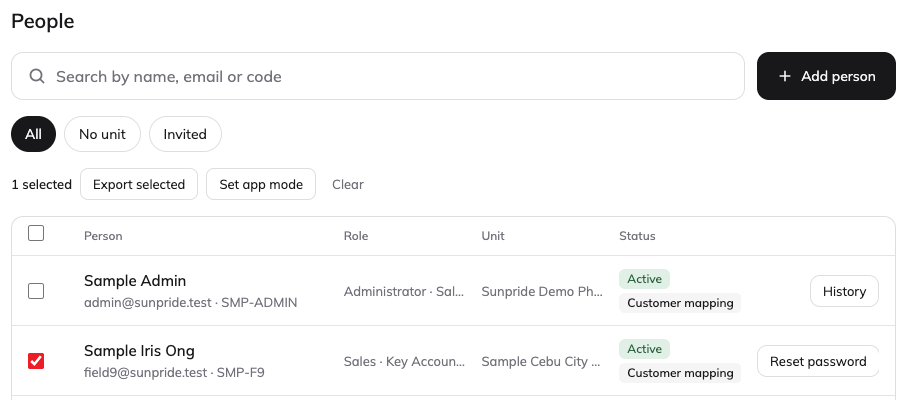

# Set a person's app mode (office)

**For office admins.** The app mode decides what a person sees in the **Sunpride Field** phone app. New people start on **Customer mapping**.

- **Customer mapping**: add and update customers. Home is one big **Add customer** button.
- **Field visits**: store visits, route and orders.
- **Truck selling**: sell from the truck and print receipts. Only people with the **Sales** role can have it.

## Change one person or many

1. Click **Setup** (left menu), then **People**.
2. Type the name in **Search by name, email or code**.
3. Tick the box at the left of the person. Tick more people to change them all at once (up to 200).
4. Click **Set app mode** (above the list).
5. Tick one or more of **Customer mapping**, **Field visits** and **Truck selling**. These replace the person's current modes.
6. Click **Save**. The top of the page confirms which modes the selected people can use.
7. The list shows each person's enabled modes under **Status**.

## On the phone

8. The phone changes at its next sync. To make it change now, the person taps **More**, then **Sync**, then **Sync now** (with signal).
9. If several modes are enabled, the phone asks **Choose app mode**. Tap the mode to use. It remembers that choice on this phone.
10. To change modes later, tap **More**, then **Switch mode**. Only the enabled modes appear. With just one mode, the phone opens it as before.
11. Nothing saved is deleted when you switch. If a sale is waiting to send, return to **Truck selling** and sync it with signal.

_The owner account has every mode and can switch on the phone (**More**, then **Switch mode**). It cannot be changed here._
_People who are not active cannot be changed. They are left out and the drawer says so._

> **If something goes wrong**
> **Save** stays grey with **Only Sales people can use Truck selling.**: one of the people you ticked is not Sales. Untick them, or pick another mode.
> The phone still shows the old screens: ask the person to tap **Sync now** with signal. Still wrong: message a **Developer** in **Messages**.
