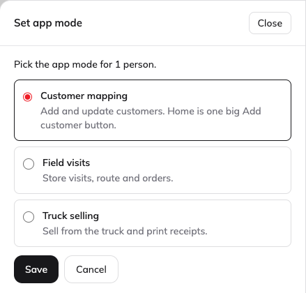

# Set a person's app mode (office)

**For office admins.** The app mode decides what a person sees in the **Sunpride Field** phone app. New people start on **Customer mapping**.

   - **Customer mapping**: add and update customers. Home is one big **Add customer** button.
   - **Field visits**: store visits, route and orders.
   - **Truck selling**: sell from the truck and print receipts. Only people with the **Sales** role can have it.

## Change one person or many

1. Click **Setup** (left menu), then **People**.
2. Type the name in **Search by name, email or code**.
3. Tick the box at the left of the person. Tick more people to change them all at once (up to 200).
4. Click **Set app mode** (above the list).
5. Pick **Customer mapping**, **Field visits** or **Truck selling**.
6. Click **Save**. The top of the page says, for example, *1 person now on Field visits.*
7. The list shows each person's mode under **Status**.

 

## On the phone

8. The phone changes at its next sync. To make it change now, the person taps **More**, then **Sync**, then **Sync now** (with signal).
9. Nothing is lost when the mode changes. Work saved on the phone stays and is sent.

*The owner account has every mode and can switch on the phone (**More**, then **Switch mode**). It cannot be changed here.*
*People who are not active cannot be changed. They are left out and the drawer says so.*

> **If something goes wrong**
> **Save** stays grey with **Only Sales people can use Truck selling.**: one of the people you ticked is not Sales. Untick them, or pick another mode.
> The phone still shows the old screens: ask the person to tap **Sync now** with signal. Still wrong: message a **Developer** in **Messages**.
