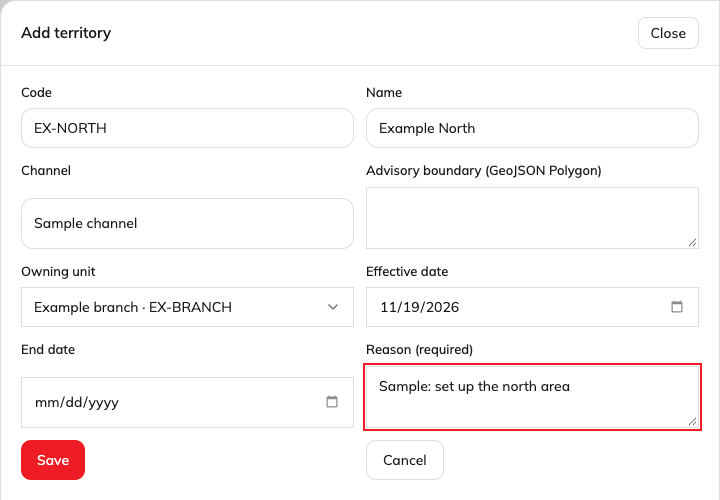
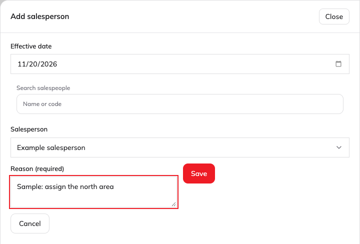
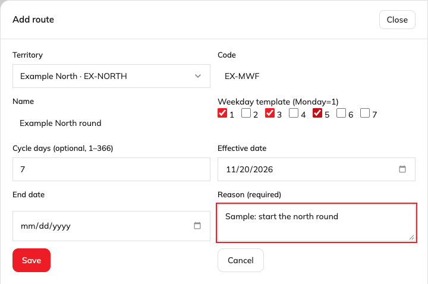
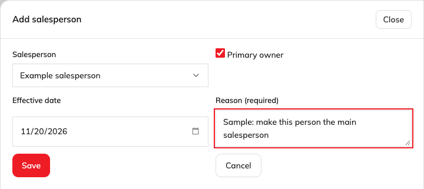
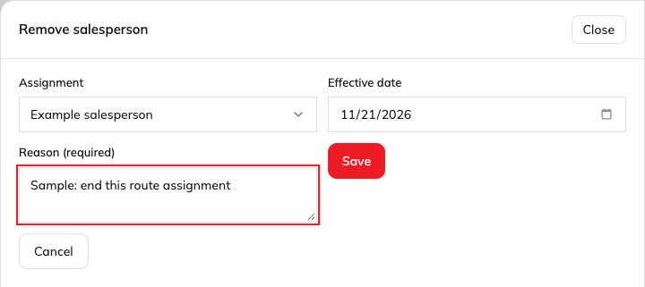
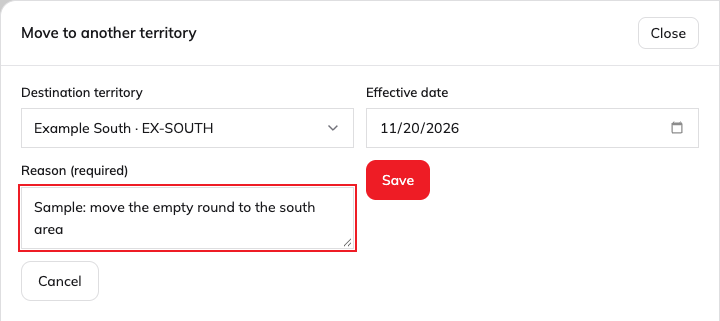
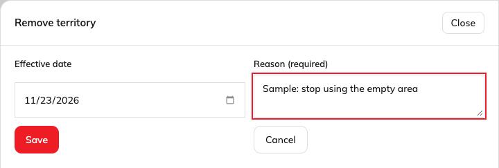

# Territories and routes

**For the office — sunpride.cauldnclark.com.** A territory is an area owned by a branch. A route groups stores within one territory. Pictures use made-up examples, not customer records.

## A. Before you start

1. Check the owning branch in **Setup > Organization** and the person's branch in **Setup > People**. They must belong to the owning branch or a branch below it.
2. **Add territory** accepts **today or later**. Every other dated change here, including adding a salesperson, needs **tomorrow or later**. Dates follow Philippine time.
3. Give a short **Reason** for every save, including edits: for example, “New north area”.

The territory and owning branch must cover the route's **whole active period**. A route cannot outlast its territory. Leave an end date blank only if there is no planned end.

## B. Add a territory

4. Open **Setup**, then **Territories** under **Places**.
5. Click **Add territory**.
6. Fill **Code** and **Name**. Use a short, unique reference in Code; use a name your team will recognise.
7. Fill **Channel** if this territory uses one. Use the wording agreed by your office; “Sample channel” in the picture is only an example. Leave the optional boundary box blank unless your office has supplied a boundary.
8. Under **Owning unit**, choose the branch responsible for the territory.
9. Choose the **Effective date**: today or later. Leave **End date** blank unless you know when the territory ends. If filled, it must be after the start date.
10. Fill **Reason (required)**, then click **Save**.
11. Find the new territory in the list. Click **Edit** beside it to see its owner, dates and **Ownership history**.

## C. Add a territory salesperson

12. In **Setup > Territories**, click **Edit** beside the territory.
13. Click **Add salesperson**.
14. Choose the **Effective date** first: tomorrow or later, while the territory is active.
15. Use **Search salespeople** or the page buttons to find the person, then choose them under **Salesperson**.
16. Fill the reason, then click **Save**.

Only active people in the territory's owning branch or a branch below it are listed here. Changing the date can change the available people. If a name is missing, check the date and their branch in **Setup > People**; do not change the territory's owner just to make a name appear.

This screen adds the **main** salesperson. There can be only one main salesperson on this territory at a time. End the old assignment before adding a replacement; the two periods must not overlap. A future assignment will not appear under **Current salespeople** until it starts.

## D. Add a route and its visit days

17. Open **Setup > Routes**, then click **Add route**. You can use the **Territory** filter to narrow the route list.
18. In the form, choose the **Territory**, then fill **Code** and **Name**.
19. Under **Weekday template (Monday=1)**, tick the usual visit days. The numbers mean **1 = Monday, 2 = Tuesday, 3 = Wednesday, 4 = Thursday, 5 = Friday, 6 = Saturday, 7 = Sunday**. For Monday, Wednesday and Friday, tick **1, 3 and 5**.
20. If you use a repeating day cycle, fill **Cycle days (optional, 1–366)** with a whole number. For example, **7** means a seven-day cycle. Leave it blank if your team does not use one. These settings describe the route's pattern; they do not by themselves create a person's visit plan.
21. Choose an **Effective date** of tomorrow or later. It must fall within the territory's active dates. Fill **End date** only if needed; it must be after the start and no later than the territory ends.
22. Fill the reason, then click **Save**.
23. Find the route and click **Edit** beside it. Check its dates, **Weekdays** and **Cycle**. A future route is listed before it starts; its current territory or salesperson details may not show until its start date.

## E. Add a route salesperson

24. In **Setup > Routes**, click **Edit** beside the route, then **Add salesperson**.
25. Choose the **Salesperson**. They must be active and belong to the branch that owns the route's territory, or a branch below it.
26. Keep **Primary owner** ticked for the main salesperson. Untick it only for an additional, secondary salesperson.
27. Choose an **Effective date** of tomorrow or later, on or after the route starts.
28. Fill the reason, then click **Save**.

One route can have only **one main salesperson at a time**. The same person cannot have two overlapping assignments on that route, even if one is secondary. Adding a territory salesperson does not also assign that person to its routes; save each route assignment separately.

The territory salesperson list is limited to the owning branch. The route salesperson list can be wider: being visible there does not mean a person belongs to the right branch. If saving says **“Person outside owner hierarchy”**, choose a person from the owning branch or a branch below it.

## F. End or replace a salesperson assignment

29. Open **Setup > Territories** or **Setup > Routes**, then click **Edit** beside the area or route.
30. Under **Current salespeople** (territory) or **Salespeople** (route), click **Remove** beside a person.
31. In **Remove salesperson**, choose the person under **Assignment**.
32. Choose the **Effective date** when the assignment should stop: tomorrow or later, after the assignment started and while the territory or route is still active.
33. Fill the reason, then click **Save**. This ends the assignment; it does **not** remove the person's account.
34. To replace the main salesperson, use **Add salesperson** afterwards. Start the replacement on the old assignment's end date or later, not before it.

The person can still appear in the current list until the end date arrives. If a future assignment is not yet listed, do not add it again; ask the office administrator to check it.

## G. Move a route to another territory

35. First move every store off the route in **Setup > Assignments**. Choose the receiving territory and another route, or **No route (territory only)**. Move the stores before the route's move date, and check future-dated store assignments too. **Preview date** and **Route stops** help you check the intended date.
36. Return to **Setup > Routes**, then click **Edit** beside the empty route.
37. Click **Move to another territory**.
38. Choose **Destination territory**. It and its owning branch must cover all the route's remaining active dates.
39. Choose the **Effective date**: tomorrow or later, while the route is active.
40. Fill the reason, then click **Save**. Check **Association history**. Recheck the salesperson's branch before using the route under its new owner.

## H. Stop using a route or territory

The buttons say **Remove route** and **Remove territory**. They stop future use from the chosen date; they do not erase the old history.

41. For a route, move all its stores off first in **Setup > Assignments**, including stores assigned for a future date.
42. In **Setup > Routes**, click **Edit** beside it, then **Remove route**.
43. Choose a future **Effective date**, after the route's start and before any existing end date. Fill the reason, then click **Save**.
44. For a territory, first move its routes and stores to another territory. It cannot stop while any current or future route or store assignment still continues there. Allow these changes to take effect before the territory's stop date.
45. In **Setup > Territories**, click **Edit** beside it, then **Remove territory**.
46. Choose a future **Effective date**, after the territory's start and before any existing end date. Fill the reason, then click **Save**.

An approved coverage plan can protect a route from changes during its dates. Ask the person responsible for that plan to arrange the change, or choose a date after the protected period. Do not try to work around the plan by adding a duplicate route.

## I. Common messages and what they mean

**“Reason required” / “Reason is required”** — Explain why you are making the change, then save again.

**“Code is required” / “Name is required” / “Invalid code”** — Fill both boxes. Code: up to 40 letters, numbers, hyphens or underscores, no spaces. Name: up to 200 characters. Use a different Code if it already exists.

**“Select a territory” / “Select a route” / “Selection is invalid”** — Reopen the correct row with **Edit**, then choose the missing territory, person or assignment.

**“Choose today or a future effective date.”** — When adding a territory, choose today or a later Philippine date, not yesterday.

**“Choose a future effective date.” / “Changes must be future-effective”** — For routes and other dated changes, choose tomorrow or later. Today is allowed only when adding a territory.

**“Invalid date” / “Invalid effective interval” / “Not active at effective time”** — Check the dates. The end must be after the start; a move or assignment must be while the area or route is active. A stop date must be after its start and before an existing end date.

**“Territory does not cover interval” / “Territory ownership gap” / “Territory owner does not cover interval”** — Choose a territory owned for the route's whole period, or shorten the route's dates. Ask the administrator to correct ownership gaps.

**“Unit does not cover effective interval” / “Territory has no owner” / “Route has no territory”** — The owning branch or territory is missing or not active for those dates. Check the owning branch and ownership history before retrying.

**“Person has no active unit” / “Person outside owner hierarchy”** — Check **Setup > People**. Choose an active person in the owning branch or a branch below it, or ask the administrator to correct the person's branch if it is wrong.

**“Future employee assignment needs revalidation”** — The person already has a later branch or role change scheduled. Ask the administrator to check that change before assigning the person here.

**“Overlapping salesperson assignment”** — End the existing main assignment before the replacement starts. Also check that the same person is not already assigned for those dates.

**“No open salesperson assignment”** — Check the person and dates. The end must be after their assignment starts and before it already ends.

**“Reassign route stops before moving route”** — Move all stores off the route in **Setup > Assignments** first, including future assignments.

**“Active or future dependents prevent deactivation”** — For a route, move its stores first. For a territory, move its routes and stores first. Check future dates as well as today's list.

**“An approved coverage plan locks this interval”** — Ask the plan's responsible manager to arrange the change, or choose a date after the protected plan ends.

**“Future interval conflicts”** — A change is already scheduled. Check **Association history** or **Ownership history** with the administrator before adding another.

**“Invalid weekday template” / “Invalid weekdays” / “Enter a whole number from 1 to 366”** — Tick only visit days 1–7. For Cycle days, use a whole number from 1 to 366 or leave it blank when adding the route.

**“Invalid boundary” / “Invalid GeoJSON” / “Boundary must be a polygon”** — Leave the optional boundary box blank when adding a territory, or ask the office for a corrected boundary. Do not type an address into that box.

**“Territory access required.” / “Route access required.”** — Ask the administrator to check your access. Missing items may be outside the area you can manage.

> **Still stuck?** Open **Messages** and send the developer a screenshot, the territory or route name, the date you chose and what you clicked. Use **Issues** for a problem that needs follow-up. Do not change people's branches or remove an area just to get past a message.
